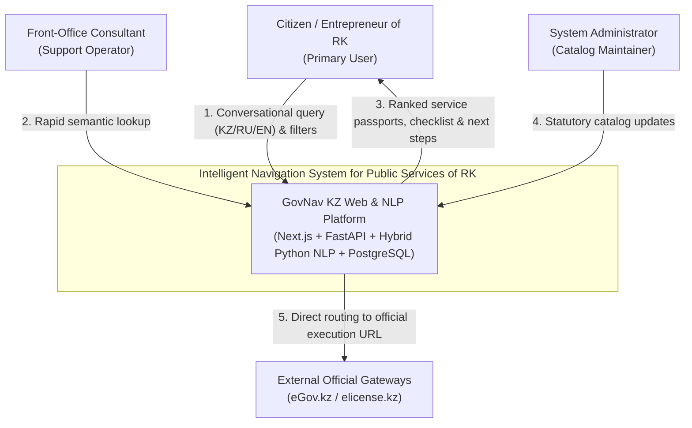
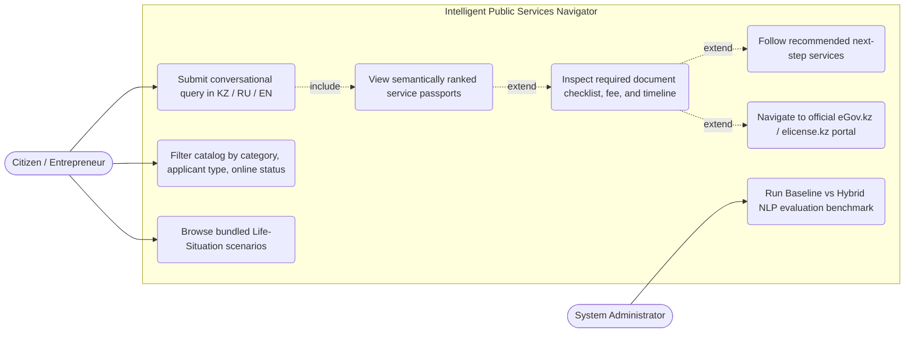
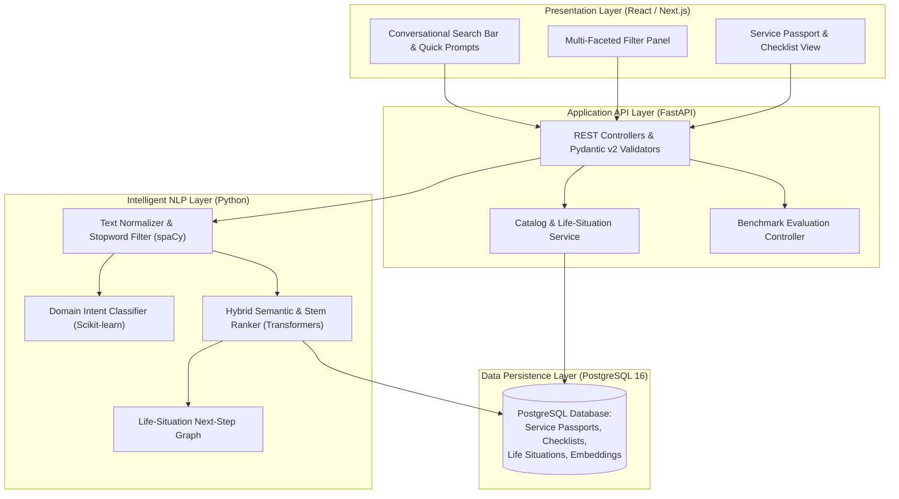
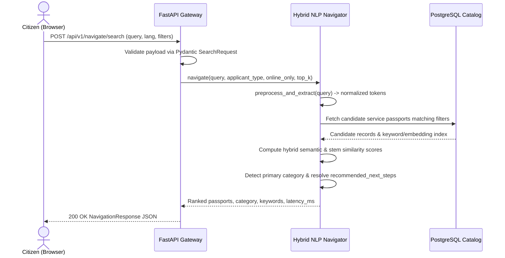

# 7. System Architecture and Diagrams

The platform implements a decoupled 4-tier architecture: **Presentation Tier (`React / Next.js`)**, **API Gateway Tier (`FastAPI`)**, **Intelligent Navigation Tier (`Python Hybrid NLP Engine`)**, and **Persistence Tier (`PostgreSQL`)**.

All editable Mermaid diagram source files are stored in the [`../diagrams/`](../diagrams/) directory:
- [`diagrams/system-context.mmd`](../diagrams/system-context.mmd)
- [`diagrams/use-case.mmd`](../diagrams/use-case.mmd)
- [`diagrams/component-diagram.mmd`](../diagrams/component-diagram.mmd)
- [`diagrams/search-sequence.mmd`](../diagrams/search-sequence.mmd)

## 7.1. System Context Diagram (C4 Level 1)

## 7.2. Use Case Diagram

## 7.3. Component Architecture Diagram (C4 Level 3)

## 7.4. Semantic Search Sequence Diagram

